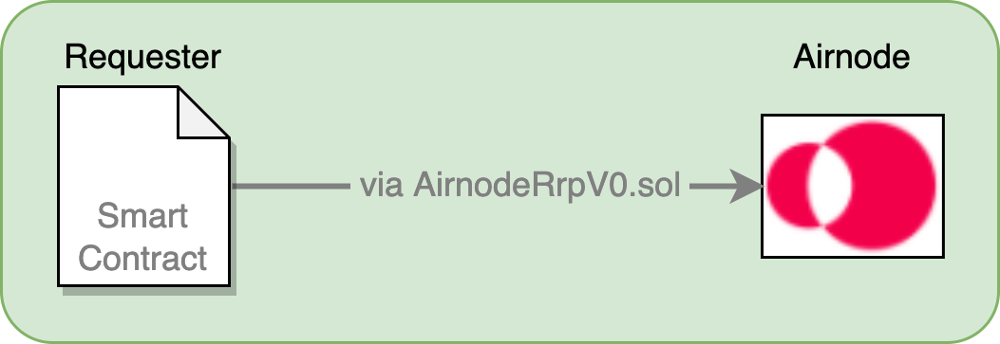
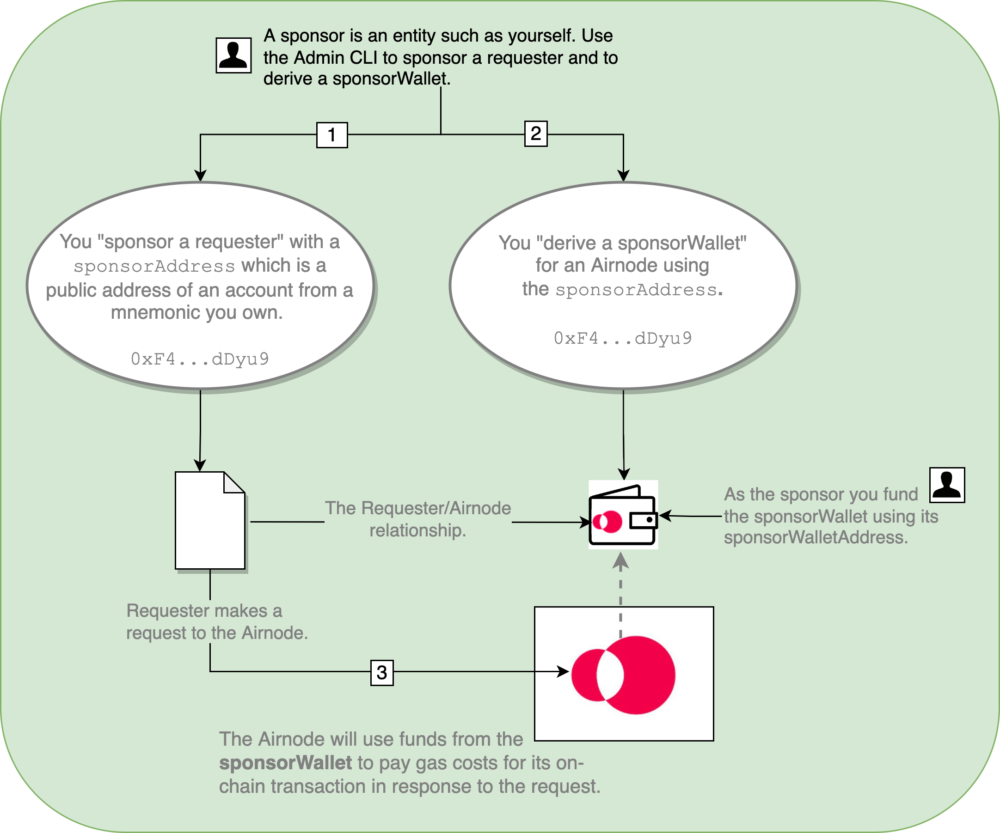

<VersionWarning/>

<PageHeader/>

<SearchHighlight/>

<FlexStartTag/>

# {{$frontmatter.title}}

As a dApp developer it helps to understand what a **requester** is and what a **sponsor** does. They are both important parts of the Airnode ecosystem. This doc will further define them and walk you through the process of sponsoring a requester and deriving a sponsor wallet using the admin CLI commands.

## What is a Requester?

The term [requester](/reference/airnode/latest/concepts/requester.md) is important to remember. When requester is mentioned, the reference is to your smart contract that makes a request of an Airnode.

> 

As an example see the `myContract.sol` contract in the diagram within the [Overview](/reference/airnode/latest/concepts/) doc, it is a requester.

## What is a Sponsor?

Equally important is the term [sponsor](/reference/airnode/latest/concepts/sponsor.md). A sponsor is an entity such as yourself, an organization, etc. Sponsors create relationships between requesters and Airnodes.

### Sponsor's Requester/Airnode Relationships

As a sponsor you will use the public address from an account within a mnemonic you own to "**sponsor a requester**" and then use the public address (known as a [sponsorAddress](/reference/airnode/latest/concepts/sponsor.md#sponsoraddress)) to "**derive a [sponsorWallet](/reference/airnode/latest/concepts/sponsor.md#sponsorwallet)**" for an Airnode. This action creates a relationship between a sponsor's requester and a particular Airnode. You do this because a sponsor is the entity that pays for the fulfillment of a request, the gas costs the Airnode will incur. These costs will be withdrawn from the `sponsorWallet` of the Airnode when the requester calls it.

::: info sponsorAddress

A [sponsorAddress](/reference/airnode/latest/concepts/sponsor.md#sponsoraddress) is a public address of an account from a mnemonic, usually the default account. Rather than the default account another account from the mnemonic can be used. The `sponsorAddress` is used to uniquely identify a sponsor.

:::

1. In the diagram below a sponsor uses a `sponsorAddress` to sponsor a requester with the Admin CLI. The CLI will use the default address of the mnemonic passed as the `sponsorAddress` for the sponsorship unless another account is specified.

2. Next the sponsor will derive a `sponsorWallet` for an Airnode using the `sponsorAddress`.
3. The requester can now make requests of the Airnode.

> 

In the above diagram it is possible to use the same sponsorAddress `(0xF4...dDyu9)` to derive other sponsor wallets for other Airnodes. And it is possible to sponsor more than one requester with the same `sponsorAddress`. However it is important to remember that all requesters can now access all the Airnodes regardless if they need to. There is no harm in this scenario.

### Advanced Scenarios

- **Two requesters, one Airnode, one sponsorWallet**:

  Two requesters sponsored with the same `sponsorAddress` (e.g., `0xF4...dDyu9`) would access the same Airnode using a single sponsorWallet derived by the `sponsorAddress`.

- **Two requesters, one Airnode, two sponsorWallets**:

  Sponsor two different requesters each with a different `sponsorAddress` (e.g., `0xF4...dDyu9` and `0xG9...fFzc5`). Using the separate sponsorAddresses you can derive two separate sponsorWallets for the same Airnode. Now each requester will deplete funds from a separate Airnode sponsorWallet when using the Airnode.

- **One requester, two Airnodes, two sponsorWallets**:

  A requester can make requests from two different Airnodes. Sponsor the requester with a `sponsorAddress`. Derive two sponsorWallets, one for each of two the Airnodes, using the `sponsorAddress`. Despite the fact that the sponsorWallet for each Airnode was derived with the same `sponsorAddress` the sponsorWallets are different since they are derived using the airnode's xpub plus the `sponsorAddress`. The sponsor must fund both wallets separately using the unique `sponsorWallet` address of the two sponsorWallets.

### Things to Remember

When you sponsor a requester with a `sponsorAddress` you are giving it permission to use the sponsorWallet (associated with a Airnode) that was derived using the same `sponsorAddress`.

When the requester makes a request to the Airnode, the Airnode will use funds from the corresponding sponsorWallet to pay gas costs in response to the request. Therefore the sponsor pays for the fulfillment of the request.

Sponsors need to keep their sponsorWallets topped off if they want Airnodes to fulfill requests made by their requesters. However this does not cover the cost of API data that the Airnode serves, see [API Provider Fees](/reference/airnode/latest/developers/fees.md#api-provider-fees).

## Admin CLI Commands

There are several sponsor and requester related commands in the [Admin CLI Commands](/reference/airnode/latest/packages/admin-cli.md) package. You can also see a list of available commands using `npx @api3/airnode-admin --help`.

In the next two sections of this doc you will use two commands from the `@api3/airnode-admin` package to _sponsor a requester_ and to _derive a sponsor wallet_.

1. [sponsor-requester](/reference/airnode/latest/packages/admin-cli.md#sponsor-requester) sponsors a requester.
2. [derive-sponsor-wallet-address](/reference/airnode/latest/packages/admin-cli.md#derive-sponsor-wallet-address)creates a sponsor wallet associated with an Airnode.

## How to Sponsor a Requester

To sponsor a requester execute the `sponsor-requester` command using the parameters detailed in the list below. Your requester should already be deployed on-chain. This command has transaction gas costs.

- `providerURL`: A blockchain provider URL (such as Infura) with providerID for the desired network.
- `sponsor-mnemonic`: Used for gas costs to fund the sponsorship and used to derive the sponsorAddress from the default address. The sponsorAddress will be needed to derive a sponsorWallet for an Airnode.
- `requester-address`: Address of the requester contract.
- `derivation-path (optional)` (_not used in the example below_): Selects an alternate account to use from the mnemonic rather than the default account.

Executing the command [sponsor-requester](/reference/airnode/latest/packages/admin-cli.md#sponsor-requester) will sponsor a requester and returns the requesterAddress and sponsorAddress.

::: code-group

```bash [Linux/Mac]
npx @api3/airnode-admin sponsor-requester \
  --providerUrl https://sepolia.infura.io/v3/<KEY> \
  --sponsor-mnemonic "cricket...oppose" \
  --requester-address 0x2c...gDER7

# Requester 0x2c...gDER7 sponsored using sponsorAddress 0xF4...dDyu9
```

```batch [Windows]
npx @api3/airnode-admin sponsor-requester ^
  --providerUrl https://sepolia.infura.io/v3/<KEY> ^
  --sponsor-mnemonic "cricket...oppose" ^
  --requester-address 0x2c...gDER7

:: Requester 0x2c...gDER7 sponsored using sponsorAddress 0xF4...dDyu9
```

:::

## How to Derive a Sponsor Wallet

To use a particular Airnode you must _derive a sponsorWallet_. Once the sponsorWallet is created it must be funded using the public address (`sponsorWallet` address) returned by the command `derive-sponsor-wallet-address`. Each Airnode keeps a separate list of individual sponsorWallets that can access the Airnode. Learn more about a [sponsorWallet](/reference/airnode/latest/concepts/sponsor.md#sponsorwallet).

To derive a sponsorWallet for an Airnode execute the [derive-sponsor-wallet-address](/reference/airnode/latest/packages/admin-cli.md#derive-sponsor-wallet-address) command using the parameters detailed in the list below. There are no transaction gas costs to do so.

- `airnode-xpub`: The extended public address of the Airnode for path m/44'/60'/0'.
- `airnode-address`: The public address of the desired Airnode.
- `sponsor-address`: The sponsorAddress (an address of an Ethereum account) owned by a sponsor. Usually the sponsorAddress is the one returned when sponsoring a requester.

The command `derive-sponsor-wallet-address` will return the public address (`sponsorWallet` address) of the sponsorWallet to be funded by the sponsor.

::: code-group

```bash [Linux/Mac]
npx @api3/airnode-admin derive-sponsor-wallet-address \
  --airnode-xpub xpub6CUGRUo... \
  --airnode-address 0xe1...dF05s \
  --sponsor-address 0xF4...dDyu9

# Sponsor wallet address: 0x14D5a34E5a370b9951Fef4f8fbab2b1016D557d9
```

```batch [Windows]
npx @api3/airnode-admin derive-sponsor-wallet-address ^
  --airnode-xpub xpub6CUGRUo... ^
  --airnode-address 0xe1...dF05s ^
  --sponsor-address 0xF4...dDyu9

:: Sponsor wallet address: 0x14D5a34E5a370b9951Fef4f8fbab2b1016D557d9
```

:::

Sponsors need to keep their sponsorWallets topped off if they want Airnodes to fulfill requests made by their requesters. However this does not cover the cost of API data that the Airnode serves, see [API Provider Fees](/reference/airnode/latest/developers/fees.md#api-provider-fees).

If you forget the public address (`sponsorWallet` address) of the sponsorWallet simply run `derive-sponsor-wallet-address` again. Since the wallet already exists for the airnodeAddress/sponsorAddress pair it will just return the address.

<SponsorWalletWarning/>

## Record Keeping

During and after sponsoring requesters and deriving a sponsorWallet there are a few things to keep track of.

| Item                   | Description                                                                                                                                                                                                                                                            |
| ---------------------- | ---------------------------------------------------------------------------------------------------------------------------------------------------------------------------------------------------------------------------------------------------------------------- |
| sponsor's mnemonic     | The mnemonic from which the `sponsorAddress` was extracted.                                                                                                                                                                                                            |
| sponsor address        | The public address of an account derived from a sponsor's mnemonic when sponsoring a requester. Record which `sponsorAddress` was used to create a sponsorWallet for each Airnode.                                                                                     |
| sponsor wallet address | Record the `sponsorWallet` address of the sponsorWallet derived for an Airnode. For each Airnode you have derived a sponsorWallet, the Airnode keeps the private key and returns the public address (`sponsorWallet` address) which is used to fund the sponsorWallet. |

You can acquire the public address (`sponsorWallet` address) of a sponsorWallet later, if you lose it, by running the command `derive-sponsor-wallet-address` again. Since the sponsorWallet was already created for the `sponsorAddress/airnodeAddress` pair, the command will only return the public address for the wallet. However you must use the same `sponsorAddress` used when the wallet was first created or a new sponsorWallet will be created.

<FlexEndTag/>
