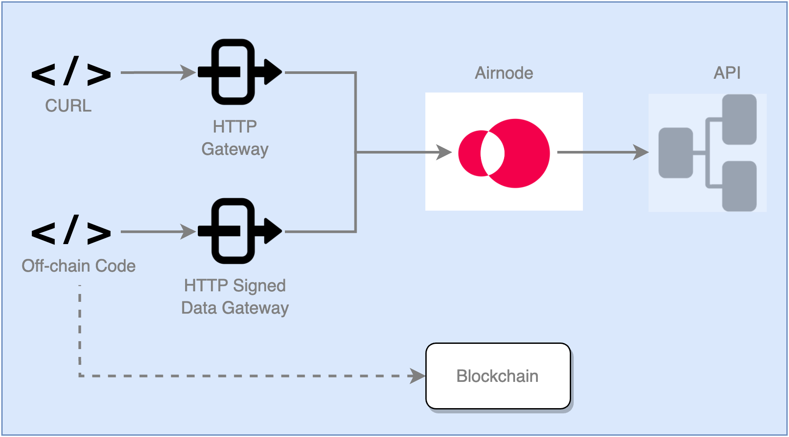

<VersionWarning/>

<PageHeader/>

<SearchHighlight/>

<FlexStartTag/>

# {{$frontmatter.title}}

As part of the Airnode deployment you can decide to deploy two different HTTP Gateways.

- HTTP Gateway: testing
- HTTP Signed Data Gateway: production use

## Gateway Differences

Both gateways are setup identically. The differences are in their purpose and response.

> 

### HTTP Gateway

The regular HTTP gateway is strictly for testing purposes. Using a simple tool like CURL you can test that endpoints in the Airnode configuration are working properly without accessing the blockchain.

In order to facilitate configuration and testing of parameters, HTTP gateway requests have the following differences in handling when compared to blockchain requests or requests to the HTTP signed data gateway:

1. When a request's API call is successful but then that response fails extraction and encoding, data are still returned. This is in contrast to the other types of requests for which only an error would be returned. The API call response, after undergoing any [post-processing](/reference/ois/next/processing.md), will be present in the `rawValue` field independent of encoding success or failure:

   ```json
   {
     "rawValue": {...}
   }
   ```

2. Reserved parameters are inaccessible in response pre/post processing. This is only relevant if reserved parameters are being _modified_ in pre/post processing (advanced use case).

### HTTP Signed Data Gateway

The HTTP signed data gateway is used for production purposes. While it is executed in a similar way as the HTTP gateway, its response is signed and does not contain a `rawValue` field. This gateway is executed by an off-chain code source that may in turn push data to a blockchain.

## Setup

Enable either gateway in the `config.json` file fields `nodeSettings.httpGateway` and `nodeSettings.httpSignedDataGateway`.

- **enabled**: A boolean to enable/disable the gateway.
- **maxConcurrency**: (optional) A number higher than zero that represents the maximum number of serverless function instance serving gateway requests. When omitted, there is no maximum concurrency set. This field is ignored for Airnode client gateways.
- **corsOrigins**: A list of allowed origins, `['*']` to allow all origins or an empty array to disable CORS.

```json
"nodeSettings": {
  "cloudProvider": {
    "type": "aws",
    "region": "us-east-1"
  },
  "airnodeWalletMnemonic": "${AIRNODE_WALLET_MNEMONIC}",
  "heartbeat": {...},
  "httpGateway": {
    "enabled": true,
    "maxConcurrency": 20,
    "corsOrigins": []
  },
  "httpSignedDataGateway": {
    "enabled": true,
    "maxConcurrency": 20,
    "corsOrigins": []
  },
  ...
},
```

Add the desired endpoints a gateway can respond to in the `triggers.http[n]` and/or `triggers.httpSignedData[n]` arrays. The corresponding arrays do not need to match. It could be practical to test all endpoints but only serve certain endpoints using the HTTP signed data gateway or via RRP.

```json
// in config.json
"triggers": {
  ...
  "http": [ // This endpoint can be served
    {       // by the http gateway
      "endpointId": "0x6db9e3e3d073ad12b66d28dd85bcf49f58577270b1cc2d48a43c7025f5c27af6",
      "oisTitle": "CoinGecko Basic Request",
      "endpointName": "coinMarketData",
    }
  ],
  "httpSignedData": [ // These endpoints can be served
    {                 // by the http httpSignedData
      "endpointId": "0x6db9e3e3d073ad12b66d28dd85bcf49f58577270b1cc2d48a43c7025f5c27af6",
      "oisTitle": "CoinGecko Basic Request",
      "endpointName": "coinMarketData",
    },
    {
      "endpointId": "5f5fa09c81d543e04c92087ac3ffe479ad55a04961cf4c9b37d897568c7ae805",
      "oisTitle": "Market Indexes",
      "endpointName": "indexByName",
    }
  ]
}
```

## Gateway URLs

The gateway implementation is different depending on how Airnode is deployed. When deployed on a cloud provider, the serverless gateway is used. Inside Airnode client, the gateway is implemented via a simple web server inside the docker container. There are subtle differences in both how the gateways work and what the gateway URLs look like.

The deployer generates a secret `UUID` path parameter which ensures that the endpoints are not openly accessible. Therefore, the gateway URLs should be kept secret.

The gateway URLs are also available as part of the payload sent from Airnode's [heartbeat](/reference/airnode/next/understand/heartbeat.md) to a specified heartbeat URL.

### When deployed on a cloud provider

A gateway URL is generated for each gateway (when enabled) when Airnode is deployed. The URL including, the secret `UUID` path parameter, is displayed on the terminal at the end of an Airnode deployment using the [Docker image](/reference/airnode/next/docker/deployer-image.md).

### When using Airnode client

Airnode client can be used to run Airnode as a docker container locally. There is a common web server for both gateways, which is exposed on the host machine. Doing so will make the gateways API accessible like a regular web server running on the machine. Each gateway has a separate endpoint as shown below. Note the `PORT` which is exposed as part of the Airnode client container. See the [Airnode client usage](/reference/airnode/next/docker/client-image.md#usage) for more details.

- `http://localhost:<PORT>/http-data/01234567-abcd-abcd-abcd-012345678abc/<endpointId>` - Gateway URL for the HTTP Gateway
- `http://localhost:<PORT>/http-signed-data/01234567-abcd-abcd-abcd-012345678abc/<endpointId>` - Gateway URL for the HTTP Signed Data Gateway

## Using CURL

In order to execute an endpoint served by either gateway, the following are required as part of the CURL call.

- Make a POST request with the `endpointId` as a path parameter. An `endpointId` can found in config.json under `triggers.http.endpointId` or `triggers.httpSignedData.endpointId`.
- Add the `Content-Type` header, set to `application/json`.
- Place the parameters/encodedParameters in the request body.

<style type="text/css" rel="stylesheet">
.tSmall { font-size:x-small; margin-left:13px;}
</style>

| CURL Parameters                                                        | In     | CURL Options                                              |
| ---------------------------------------------------------------------- | ------ | --------------------------------------------------------- |
| Content-Type                                                           | header | `-H 'Content-Type: application/json'`                     |
| endpointId                                                             | path   | `<gatewayUrl>/0x6db9e3e3d0...c7025f5c27af6`               |
| \* parameters<div class="tSmall">HTTP Gateway</div>                    | body   | `-d '{"parameters": {"param1": "myValue", "param2": 5}}'` |
| \* encodedParameters<div class="tSmall">HTTP Signed Data Gateway</div> | body   | `-d '{"encodedParameters": "0x3173737300....000"}'`       |

\* Parameters for the gateways are named differently. The HTTP signed data gateway requires that the `encodedParameters` be encoded using [Airnode ABI](/reference/airnode/next/specifications/airnode-abi.md).

### Request

Replace `<gatewayUrl>` in the examples below with the URL displayed in the terminal at the end of an Airnode deployment using a [Docker image](/reference/airnode/next/docker/).

::: code-group

```sh [HTTP Gateway]
curl \
-X POST \
-H 'Content-Type: application/json' \
-d '{"parameters": {"param1": "myValue", "param2": 5}}' \
'<gatewayUrl>/0x6db9e3e3d0...c7025f5c27af6'
```

```sh [HTTP Signed Data Gateway]
curl \
-X POST \
-H 'Content-Type: application/json' \
-d '{"encodedParameters": "0x3173737300....000"}' \
'<gatewayUrl>/0x6db9e3e3d0...c7025f5c27af6'
```

:::

### Response

::: code-group

```json [HTTP Gateway]
{
  "rawValue": { "usd": "6421.4" },
  "encodedValue": "0x0000000000000000000000000000000000000000000000000000000ef373e180",
  "values": ["64214000000"]
}

rawValue: the API response
encodedValue: the encoded bytes value that is sent as payload in the response transaction on chain
values: an array of values after they are [extracted and converted](/reference/airnode/next/packages/adapter.md#conversion) to the target type

```

```json [HTTP Signed Data Gateway]
{
  "timestamp": "1648226003",
  "encodedValue": "0x0000000000000000000000000000000000000000000000000000000a571a14c0",
  "signature": "0xa74e4312e2e6fa2de2997ef43e417e3b82d0019ac2a84012300f706f8b213e0d6e1ae9301052ec25b71addae1b1bceb4617779abfc6acd5a951e20a0aaabe6f61b"
}

timestamp: The UNIX timestamp applied to the response.
encodedValue: The encoded bytes value that is sent as payload in the response. Suitable for use on-chain.
signature: The response has been signed by Airnode.
```

:::

<FlexEndTag/>
