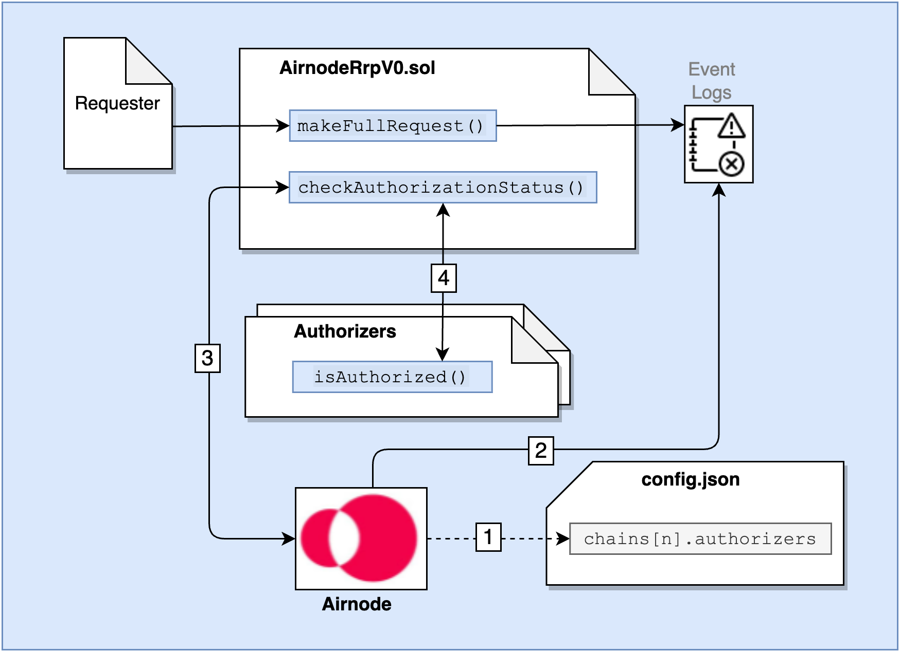

<VersionWarning/>

<PageHeader/>

<SearchHighlight/>

<FlexStartTag/>

# {{$frontmatter.title}}

An Airnode can authorize requester contract access to its underlying API using authorizers. As an alternative, an API provider could also use [Relayed Meta Data Authentication](/reference/airnode/v0.11/concepts/relay-meta-auth.md) to authenticate requests. Authorizers require blockchain knowledge by the API provider, relayed meta data does not.

When an Airnode receives a request, it can use on-chain authorizer contracts to verify if a response is warranted. Authorizers allow Airnodes to implement a wide variety of policies. Below are some examples:

- Respond to requests from sponsors that have paid their monthly subscription fee in DAI.
- Respond to individual requests for which a per-call fee has been paid in API3 tokens.
- Respond to requests made by requesters that were whitelisted by the API3 DAO.
- Respond to requests made by sponsors who have been whitelisted by the Airnode owner's backend (for example, based on PayPal payments).

A common use case for an authorizer is the [RequesterAuthorizerWithAirnode](/reference/airnode/v0.11/concepts/authorizers.md#requesterauthorizerwithairnode) authorizer contract developed for Airnode operators to use right out-of-the-box. It allows the whitelisting of requester contracts (with or without expiration timestamps) on a per endpoint basis. This is the most common use case and may in fact satisfy the needs of many Airnodes.

The diagram below illustrates how Airnode utilizes authorizers.

> 
>
> 1. <p class="diagram-line">When Airnode starts it reads its list of authorizer contracts declared in <code>config.json</code>.</p>
> 2. <p class="diagram-line">Airnode gathers requests from the event logs, during its run cycle.</p>
> 3. <p class="diagram-line">Airnode sends each request, along with the list of authorizer contracts, to <code>checkAuthorizationStatus()</code>.</p>
> 4. <p class="diagram-line"><code>checkAuthorizationStatus()</code> executes the <code>isAuthorized()</code> function in each authorizer contract. If any one authorizer contract returns true, then true is returned to the Airnode which in turn proceeds to fulfill the request.</p>

## Airnode Authorizer Policies

Airnode provides two authorizer contracts, one of which (`RequesterAuthorizerWithAirnode`) can be used by any API provider. The other (`RequesterAuthorizerWithManager`) is meant to be used by the API3 DAO. They are detailed within this doc in sections below.

- [RequesterAuthorizerWithAirnode](/reference/airnode/v0.11/concepts/authorizers.md#requesterauthorizerwithairnode)
- [RequesterAuthorizerWithManager](/reference/airnode/v0.11/concepts/authorizers.md#requesterauthorizerwithmanager)

Both these authorizer contracts inherit and extend the `RequesterAuthorizer` abstract contract which also extends the `Whitelist` contract. This means that both authorizer contracts will need to whitelist requester contracts prior to make them available to an Airnode. For `RequesterAuthorizerWithAirnode` this can be done using the [admin-cli](/reference/airnode/v0.11/packages/admin-cli.md#requesterauthorizerwithairnode).

The main difference between them is that `RequesterAuthorizerWithAirnode` allows the Airnode address to grant whitelisting roles for that specific Airnode. On the other hand, `RequesterAuthorizerWithManager` allows the manager address (read: the API3 DAO) to grant whitelisting roles for all Airnodes that use it.

Some common functions available are:

- `requesterIsWhitelisted`: Called to check if a requester is whitelisted to use the Airnode–endpoint pair.
- <code style="  overflow-wrap: break-word;">airnodeToEndpointIdToRequesterToWhitelistStatus</code>: Called to get the detailed whitelist status of a requester for the Airnode–endpoint pair.

### Custom Authorizers

Custom authorizer contracts can implement any arbitrary authorization logic. An example might be where Airnode only responds to requests if the requester has made less than a specific number of requests to the Airnode in the last month, effectively implementing an on-chain call quota.

### Authorizer List

Airnode authorizers are listed in the config.json file at [chains[n].authorizers](/reference/airnode/v0.11/understand/configuring.md#chains). An authorizer typically checks for a single condition (has the requester made their monthly payment, is the `requester` whitelisted, etc.). Authorizers can be combined to enforce more complex policies. If any of the authorizers in `chains[n].authorizers` gives access, the request will considered to be authorized. From a logical standpoint, the authorization outcomes get *OR*ed.

### Authorizer Interface

Authorizer contracts that inherit from `IAuthorizer` can be used to implement an arbitrary authorization policy based on its input parameters.

- `requestId`: bytes32
- `airnode`: address
- `endpointId`: bytes32
- `sponsor`: address
- `requester`: address

Note that the authorizer does not have to use all of the arguments, and can even decide on arbitrary on-chain criteria such as `block.number` (e.g., do not respond to anyone after block number N). An authorizer is a contract with the following interface:

```solidity
interface IAuthorizerV0 {
  function isAuthorizedV0(
      bytes32 requestId,
      address airnode,
      bytes32 endpointId,
      address sponsor,
      address requester
  ) external view returns (bool);
}
```

Below is an example of how to create the simplest form of an authorizer. This authorizer allows any requester contract to call the endpointId (0xf2ee...).

```solidity
// SPDX-License-Identifier: MIT
pragma solidity 0.8.9;

import "@api3/airnode-protocol/contracts/authorizers/interfaces/IAuthorizerV0.sol";

contract MyAuthorizer is IAuthorizerV0
{
  function isAuthorizedV0(
    bytes32 requestId,
    address airnode,
    bytes32 endpointId,
    address sponsor,
    address requester
  ) external view override returns (bool) {
    bytes32 expected = 0xf2ee...;
    return endpointId == expected;
  }
}
```

### Why is an authorizers scheme needed?

Airnodes need the ability to fulfill requests selectively. This is required for two main reasons:

1. The Airnode only fulfills requests made by requesters who have made payment to the Airnode owner, which allows them to monetize their services.
2. The services of the Airnode are sensitive and can only be accessed by certain requesters, e.g., who have gone through KYC.

A protocol that does not have the `authorizers` scheme or equivalent functionality cannot be considered as permissionless, and will not be able to achieve wide-spread adoption.

### Are authorizers required?

Authorizers are not required. An Airnode operator could use [Authorizations](/reference/airnode/v0.11/concepts/authorizations.md) or [Relayed Meta Data Security Schemes](/reference/airnode/v0.11/concepts/relay-meta-auth.md). It is possible to use both authorizers, authorizations, and relay security schemes together.

## How are authorizers implemented?

There are two main points to consider about how authorization policies are implemented:

1. If the policies are kept off-chain, the requester cannot see them or check if they satisfy them. Furthermore, the Airnode owner updating the policies (e.g., increasing the service fees) requires off-chain coordination with the requester.
2. Embedding the policies in the request–response loop results in a gas cost overhead.

Based on these considerations, Airnode uses a hybrid method. An Airnode announces its authorization policy through off-chain channels as the addresses of a list of authorizer contracts. Whenever the Airnode receives a request, it checks if it should fulfill this request by making a static call that queries this on-chain policy. Similarly, the requester can use this on-chain policy by making a static call to check if they are authorized. This scheme both allows the Airnode to set transparent and flexible policies, and this to be done with no gas overhead.

Currently there are four `authorizers` scheme types:

- `requesterEndpointAuthorizers`
- `crossChainRequesterAuthorizers`
- `requesterAuthorizersWithErc721`
- `crossChainRequesterAuthorizersWithErc721`

These are set in `chains[n].authorizers` of `config.json` as described below.

### Special case: all authorizers values are empty arrays

When all `chains[n].authorizers` values are empty arrays, all requests are authorized. In the example below, all chain _2_ requests are authorized.

```json
"chains": [
  {
    "id": "2",
    "authorizers": {
      "requesterEndpointAuthorizers": [],
      "crossChainRequesterAuthorizers": [],
      "requesterAuthorizersWithErc721": [],
      "crossChainRequesterAuthorizersWithErc721": []
    }
    ...
  },
  ...
]
```

### Same-chain: requesterEndpointAuthorizers

The `requesterEndpointAuthorizers` authorizer scheme type specifies an array of on-chain contract addresses to query when attempting to authorize a request. In contrast to the analogous `crossChainRequesterAuthorizers` authorizer scheme type, the contract addresses are expected to reside on the chain specified by the `id` field of the parent `chains` object i.e. the authorizer contract addresses are on the same chain.

In the example below, a request would be authorized on chain _2_ if _either_ of the two `requesterEndpointAuthorizers` contracts authorize the request.

```json
"chains": [
  {
    "id": "2",
    "authorizers": {
      "requesterEndpointAuthorizers": ["0xcd...cd8d", "0xff...d19c"],
      "crossChainRequesterAuthorizers": [],
      "requesterAuthorizersWithErc721": [],
      "crossChainRequesterAuthorizersWithErc721": []
    }
  }
]
```

### Cross-chain: crossChainRequesterAuthorizers

The `crossChainRequesterAuthorizers` authorizer scheme type specifies an array of objects that allow for cross-chain request authorization. The key-value pairs of each object resemble other `config.json` objects: `requesterEndpointAuthorizers` specifies an array of contract address that authorize requests and both `chainType` and `contracts` are configured equivalently to their like named parent `chains[n]` objects described in the [config.json reference](/reference/airnode/v0.11/deployment-files/config-json.md#chains). Lastly, `chainId` specifies the cross-chain (network) id and `chainProvider` is an object containing the chain provider url for the _chain specified by `chainId`_.

Note that `crossChainRequesterAuthorizers` is an array that can contain multiple cross-chain authorizer objects, which allows for authorizers across multiple chains and/or redundancy in providers for each chain.

In the below example, requests will be authorized if the cross-chain (`"chainId": "1"`) authorizer contract `0xCE5e...1abc` authorizes the request.

```json
"chains": [
  {
    "id": "2",
    "authorizers": {
      "requesterEndpointAuthorizers": [],
      "crossChainRequesterAuthorizers": [
        {
          "requesterEndpointAuthorizers": ["0xCE5e...1abc"],
          "chainType": "evm",
          "chainId": "1",
          "contracts": {
            "AirnodeRrp": "0xa0AD...a1Bd"
          },
          "chainProvider": {
            "url": "https://mainnet.infura.io/..."
          }
        }
      ],
      "requesterAuthorizersWithErc721": [],
      "crossChainRequesterAuthorizersWithErc721": []
    }
  }
]
```

## Pre-built Authorizer Contracts

Airnode provides two authorizer contracts, one of which (RequesterAuthorizerWithAirnode) can be used by any API provider. The other (RequesterAuthorizerWithManager) is meant to be used by the API3 DAO. Custom authorizer contract can also be created to provide other verification logic.

### RequesterAuthorizerWithAirnode

This contract implements a requester-based RRP authorizer with three types of roles.

1. **Whitelist expiration extender**: Is allowed to extend temporary whitelisting expiration.
2. **Whitelist expiration setter**: Is allowed to set the temporary whitelisting expiration (i.e., they can also reduce the expiration time).
3. **Indefinite whitelister**: Is allowed to whitelist/unwhitelist indefinitely Each Airnode's address is treated as if they have all these three roles for the respective Airnode, and they can also grant these roles to other accounts, which includes contracts that implement arbitrary business logic.

#### extendWhitelistExpiration

The `extendWhitelistExpiration()` function can be called by a whitelist expiration extender or the Airnode address to extend the whitelist expiration of a requester for the Airnode–endpoint pair.

This function emits a `ExtendedWhitelistExpiration` event with the following signature:

```solidity
event ExtendedWhitelistExpiration(
  address indexed airnode,
  bytes32 endpointId,
  address indexed requester,
  address indexed sender,
  uint256 expiration
);
```

#### setWhitelistExpiration

The `setWhitelistExpiration()` function can be called by a whitelist expiration setter or the Airnode address to set the whitelisting expiration of a requester for the Airnode–endpoint pair. This can hasten expiration.

This function emits a `SetWhitelistExpiration` event with the following signature:

```solidity
event SetWhitelistExpiration(
  address indexed airnode,
  bytes32 endpointId,
  address indexed requester,
  address indexed sender,
  uint256 expiration
);
```

#### setWhitelistStatusPastExpiration

The `setWhitelistStatusPastExpiration()` function can be called by an indefinite whitelister or the Airnode address to set the whitelist status of a requester past expiration for the Airnode–endpoint pair. This is useful to allow access to an API even if the expiration date has passed. For example, keep authorizing requests while a sum of API3 tokens is locked.

This function emits a `ExtendedWhitelistExpiration` event with the following signature:

```solidity
event SetWhitelistStatusPastExpiration(
  address indexed airnode,
  bytes32 endpointId,
  address indexed requester,
  address indexed sender,
  bool status
);
```

#### isAuthorized

The `isAuthorized()` function will be called by AirnodeRrpV0 to verify the authorization status of a request. This function will return true for all whitelisted requester contracts, admins and Airnode operator address.

### RequesterAuthorizerWithManager

This contract implements a requester-based RRP authorizer and assigns the API3 DAO as the manager or in other words, the highest ranking admin across all Airnodes.

The manager and the accounts that it has granted the whitelist expiration extender, whitelist expiration setter and the indefinite whitelister roles will use `RequesterAuthorizerWithManager` to whitelist requesters across all Airnodes.

#### extendWhitelistExpiration

The `extendWhitelistExpiration()` function can be called by a whitelist expiration extender or the manager to extend the whitelist expiration of a requester for the Airnode–endpoint pair.

This function emits a `ExtendedWhitelistExpiration` event with the following signature:

```solidity
event ExtendedWhitelistExpiration(
  address indexed airnode,
  bytes32 endpointId,
  address indexed requester,
  address indexed sender,
  uint256 expiration
);
```

#### setWhitelistExpiration

The `setWhitelistExpiration()` function can be called by a whitelist expiration setter or the manager to set the whitelisting expiration of a requester for the Airnode–endpoint pair. This can hasten expiration.

This function emits a `SetWhitelistExpiration` event with the following signature:

```solidity
event SetWhitelistExpiration(
  address indexed airnode,
  bytes32 endpointId,
  address indexed requester,
  address indexed sender,
  uint256 expiration
);
```

#### setWhitelistStatusPastExpiration

The `setWhitelistStatusPastExpiration()` function can be called by an indefinite whitelister or the manager to set the whitelist status of a requester past expiration for the Airnode–endpoint pair. This is useful to allow access to an API even if the expiration date has passed. For example, keep authorizing requests while a sum of API3 tokens is locked.

This function emits a `ExtendedWhitelistExpiration` event with the following signature:

```solidity
event SetWhitelistStatusPastExpiration(
  address indexed airnode,
  bytes32 endpointId,
  address indexed requester,
  address indexed sender,
  bool status
);
```

#### isAuthorized

The `isAuthorized()` function will be called by AirnodeRrpV0 to verify the authorization status of a request. This function will return true for all whitelisted requester contracts, admins and the meta-admin address.

<FlexEndTag/>
