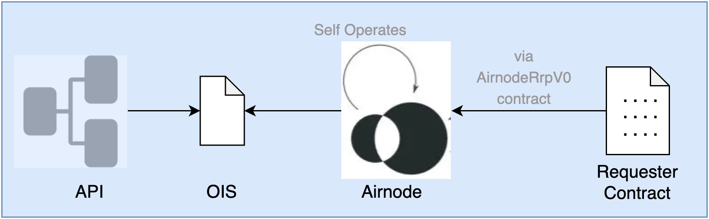

<VersionWarning/>

<PageHeader/>

<SearchHighlight/>

<FlexStartTag/>

# {{$frontmatter.title}}

A successful integration of an API with an Airnode requires the mapping of each other's interface. This is accomplished using an OIS ([Oracle Integration Specifications](/reference/ois/2.1/specification.md)) json object, found in the config.json file, designed to with three basic steps.

1. API operations are specified
1. Airnode endpoints are specified
1. Airnode endpoints are mapped to API operations

<!-- prettier-ignore-->
>
> 
>
> <p style="font-size:small;width:80%;">The OIS object in config.json contains mapping information of API operations to Airnode endpoint definitions.</p>

OIS is a mapping of API operations, such as `GET /coins/{id}`, to Airnode endpoints. When a requester contract calls one of the AirnodeRrpV0.sol contract's request functions, such as `makeFullRequest(..., callData)`, the callData is communicated to the off-chain Airnode which uses OIS mappings to translate the callData into a valid HTTP request for the appropriate API operation.

OIS borrows formatting from [OAS OpenAPI Specification](https://github.com/OAI/OpenAPI-Specification/blob/master/versions/3.0.3.md). If you have experience with OAS, OIS will seem familiar.

::: info OAS

It is not recommended to refer to OAS for help while creating your OIS object. OIS only borrows formatting practices from OAS. Everything needed to create an OIS object is in these docs.

:::

**Tips while reading ths page.**

- Open the [OIS template](/reference/ois/2.1/template.md) in another browser window to follow along.
- View an example of an Airnode [config.json](/reference/airnode/v0.11/deployment-files/examples/config-json.md) file.

## OIS Template

OIS is a json object that is added to an Airnode's [config.json](/reference/airnode/v0.11/deployment-files/templates/config-json.md) file as the (`ois`) _key_, sometimes called a _field_. Try using the [OIS template](/reference/ois/2.1/template.md) to construct an OIS and add it to the Airnode's config.json file later.

In the OIS template, there are some fields that contain `{FILL_*}`. This means that the value added is independent from other fields. On the other hand, if two fields contain the same expression (e.g., `{FILL_OPERATION_PARAMETER_1_NAME}`), you must use the same value in them, because they are referencing each other.

OIS uses a simplified version of the OAS. This means that if you have the OpenAPI specifications of the API that you are going to integrate, you are about 80% done, because you can copy paste entire sections (but be sure to make the necessary modifications to conform to the OIS format).

The remainder of this page will assume you do not have the OpenAPI specifications of the API that you will be integrating.

<!--------------- STEP 1 ---------------->

## 1. Specify OIS Definitions

Start building an OIS by adding three descriptive fields to the root of the OIS json object.

```json
{
  "oisFormat": "2.1.0",
  "title": "myOisTitle",
  "version": "0.1.0",
  ...
}
```

### oisFormat

A specific version of the [OIS Specification](/reference/ois/2.1/specification.md#_1-oisformat) to be used. For Airnode `v0.11.2`, the proper OIS version is `2.1.0`.

### title

This is a unique title of the OIS. Note that an Airnode can be configured with more than one OIS object and uses the title as the OIS identifier.

### version

This is the version of the OIS which allows for version-control of the OIS integration. It is recommended to use [semver](https://semver.org/) versioning. The initial version could be `0.1.0`.

<!--------------- STEP 2 ---------------->

## 2. Specifying the API

The `apiSpecifications` field is used to describe the API and its operations.

```json
"oisFormat": "2.1.0",
"title": "myOisTitle",
"version": "0.1.0",
"apiSpecifications": {
  "servers": [...],
  "paths": {...},
  "components": {...}
}
```

### Servers

The first step of specifying an API is to enter its _baseURL_ in the `apiSpecifications.servers[0].url` field. Only one object (i.e., url) is allowed in the `apiSpecifications.servers` array. A warning is raised during conversion if servers has multiple elements. This baseURL will apply to all operations.

#### Choosing a Base URL

Consider the following full URL to execute an API operation that returns all know tokens.

<!-- markdown-link-check-disable-next-line -->

> `https://www.myapi.com/v1/tokens`

There are two ways to segment this.

<!-- markdown-link-check-disable-next-line -->

> **baseURL:** `https://www.myapi.com`
>
> **path:** `/v1/data`

or

<!-- markdown-link-check-disable-next-line -->

> **baseURL**: `https://www.myapi.com/v1`
>
> **path:** `/data`

Because the call will be made to <`baseURL+path`> both will result in the same full URL.

<!-- markdown-link-check-disable-next-line -->

Set the baseURL as the section of the full URL that you expect to be shared by all operations. From the examples above it is recommended to use `https://www.myapi.com`, in case additional paths starting with `/v2` get added to the API in the future. As you can tell, API integration requires many subjective choices, and is more art than science.

```json
"apiSpecifications": {
  "servers": [ // Only one element is allowed in the servers array.
    {
      "url": "https://www.myapi.com"
    }
  ],
  ...
}
```

### Paths

The _paths_ field defines all the API operations much like an OpenAPI Specification file.

_What is an API operation?_

> An API operation is specified as a unique combination of a _**path**_ and an HTTP _**method**_. `GET /token/{id}`

#### Operations

In the examples below, `GET` refers to an [HTTP request method](https://developer.mozilla.org/en-US/docs/Web/HTTP/Methods). This implies that you could have another API operation that can be specified using a different method but the same path.

> path: /data
>
> method: GET

> path: /data
>
> method: POST

Therefore, a path is not enough to specify an API operation by itself, you must also provide a method. If a new path is needed then it must be a new object in paths with its own methods. Currently only the GET and POST methods are supported by Airnode.

With regards to the [OIS template](/reference/ois/2.1/template.md), the name of the element (denoted as `{FILL_PATH}`) should be replaced with the path (e.g., `/data`). Similarly, `{FILL_METHOD}` should be replaced with the method of the operation to integrate (e.g., `get`). The method must be lowercase.

The following example illustrates three operations, `GET /data`, `POST /data`, `GET /tokens`.

```json
"paths": {
  "/data": {   // path    {FILL_PATH}
    "get": {   // method  {FILL_METHOD}
      ...      // parameters
    },
    "post": {  // method  {FILL_METHOD}
      ...      // parameters
    }
  },
  "/tokens": { // path    {FILL_PATH}
    "get": {   // method  {FILL_METHOD}
      ...      // parameters
    }
  }
}
```

#### Parameters (operation)

After specifying the path and method of an API operation, the final step is to specify its parameters. Each parameter is an object in the `apiSpecifications.paths.{PATH}.{METHOD}.parameters` array, with the fields `in` and `name`. `in` tells where the parameter goes in the HTTP request and `name` tells the name that the parameter value will be sent under. Currently Airnode supports the following parameter types for use with `in`.

- query
- header
- path
- cookie

When integrating a POST method, define the body parameters with `in: query`. Airnode will convert all `query` types into the `requestBody`. Note that only the non-nested application/json content-type is supported.

It is not necessary to specify all API operation parameters, but only the ones the on-chain requester will need to be able to provide (see Airnode endpoint [parameters](/reference/airnode/v0.11/understand/api-integration.md#parameters)), and the ones needed to hard-code a value for (see Airnode endpoint [fixed operation parameters](/reference/airnode/v0.11/understand/api-integration.md#fixedoperationparameters)).

```json
"paths": {
  "/data/{id}": {
    "get": {
      "parameters": [
        {
          "in": "path",
          "name": "id"
        },
        {
          "in": "header",
          "name": "Accept"
        }
      ]
    }
  }
}
```

_Example: Get a token_

The `GET /token/{id}` returns a token using the token's `id` which is a `path` parameter.

| Method | Path        | in   | name |
| ------ | ----------- | ---- | ---- |
| GET    | /token/{id} | path | id   |

_Example: Create a token_

The `POST /token` operation accepts three parameters. The name and description of the token are placed in the type `query` and will be moved by Airnode to the requestBody upon calling the API operation. The third is a `header` parameter that describes the Content-Type of the request such as `application/json` or `application/x-www-form-urlencoded`.

| Method | Path   | in     | name        |
| ------ | ------ | ------ | ----------- |
| POST   | /token | query  | name        |
|        |        | query  | description |
|        |        | header | Accept      |

_Example: Get all tokens_

The `GET /tokens` returns a list of all tokens. The list count can be limited using the `limit' parameter which the API operation considers as optional since it will not return an error if omitted.

> `GET /tokens` returns all tokens.
>
> `GET /tokens?limit=10` returns the first ten tokens.

| Method | Path    | in    | name  |
| ------ | ------- | ----- | ----- |
| GET    | /tokens | query | limit |

<!--------------- STEP 1 ---------------->

## 3. Specifying Airnode Endpoints

An Airnode endpoint is a service that Airnode exposes to on-chain requesters. It maps to an API operation, but the nature of this mapping is customizable. It is the integrator's job to define what this service is.

For example, if an API operation returns an asset price given its ticker (e.g., `BTC`), specify the endpoint such that the requester provides the ticker as a parameter. The resulting endpoint would be a general one that returns prices for any kind of asset. On the other hand, hardcoding `BTC` as the asset whose price will be returned (using [fixed operation parameters](/reference/airnode/v0.11/understand/api-integration.md#fixedoperationparameters)), which would make the endpoint a specific one that only returns the BTC price.

The recommended endpoint definition pattern is to create an Airnode endpoint for each API operation, and allow the requesters to provide all operation parameters themselves. This results in optimal flexibility, and essentially allows the requesters to use the entire API functionality on-chain. Normally, competitor oracle integrations strive to hard-code as many API parameters as possible because passing these parameters on-chain results in a gas cost overhead. However, the Airnode protocol uses [templates](/reference/airnode/v0.11/concepts/template.md) (not to be confused with the OIS template used for this guide), which allow requesters to specify a large number of endpoint parameters at no additional gas cost.

Note that there are some cases where you may not want to map endpoints to API operations one-to-one. For example, an API operation can have a `header` parameter, `Accept`, that can take the values `application/json` or `application/xml` to determine how to format the data that the API will respond to the call. Airnode expects responses to be in JSON format, and thus hard-coding this parameter as `JSON` would be more suitable than letting the requester decide, as there is only one valid choice. Again, the integrator's job is to be aware of these subtleties and use judgement.

### Endpoints array

The field `endpoints` is an array, with each row representing an Airnode endpoint. The first field to fill in is `name`. Make sure that it is descriptive and unique from other endpoint names. If you are integrating API operations to Airnode endpoints one-to-one, using the API operation path as the endpoint name is a decent choice (i.e., `/token`). Note that you would also add the method to this name if there were multiple operations with different methods for a single path (i.e., `GET/token`).

The next step is to fill in `operation` object. Here, you need to enter the `path` and `method` of an API operation you have defined in `apiSpecifications.paths`, resulting in the Airnode endpoint calling the now linked API operation.

#### fixedOperationParameters

It is not uncommon to hard-code API parameters (recall the `Accept` operation parameter in the above example). Such hard-coded parameters are called `fixedOperationParameters`.

In the OIS template there is a fixed operation parameter under `endpoints[n].fixedOperationParameters`, and it refers to the first API operation parameter. This means that whenever the Airnode receives a request for this endpoint, the respective API call will be made with that API operation parameter set to <code style="overflow-wrap:break-word;">endpoints[n].fixedOperationParameters[n].value</code>. The requester does not supply a value for `fixedOperationParameters`.

```json
"fixedOperationParameters": [
  {
    "operationParameter": {
      "in": "<FILL_OPERATION_PARAMETER_1_IN>",
      "name": "<FILL_OPERATION_PARAMETER_1_NAME>"
    },
    "value": "<FILL_*>"
  }
  ],

```

An Airnode endpoint can have multiple `fixedOperationParameters`. An API operation parameter cannot be in both `endpoints[n].fixedOperationParameters` and `endpoints[n].parameters`.

#### reservedParameters

The requester can provide some parameters that are not mapped to API operation parameters. These parameters are called "reserved parameters", and their names start with an underscore. See the [related OIS docs](/reference/ois/2.1/specification.md#_5-4-reservedparameters) for more information.

The current list of reserved parameters are `_type`, `_path`, `_times`, `_gasPrice`, and `_minConfirmations`. See [Reserved Parameters](/reference/ois/2.1/reserved-parameters.md) in the OIS document set to understand what each of these parameters are for.

#### parameters

Airnode endpoint [parameters](/reference/ois/2.1/specification.md#_5-5-parameters) map to API operation [parameters](/reference/ois/2.1/specification.md#_4-2-1-parameters) that the requester is allowed to provide values for. It refers to an API operation through its field `operationParameter`. You can also provide `default` values for endpoint parameters, though this is not recommended in most cases.

```json
// apiSpecifications.paths.<FILL_PATH>.<FILL_METHOD>.parameters[1]
"paths": {
  "<FILL_PATH>": {
    "<FILL_METHOD>": {
      "parameters": [
        {
          "in": "<FILL_OPERATION_PARAMETER_1_IN>",
          "name": "<FILL_OPERATION_PARAMETER_1_NAME>"
        },
        {
          "in": "<FILL_OPERATION_PARAMETER_2_IN>", <──────────┐
          "name": "<FILL_OPERATION_PARAMETER_2_NAME>" <─────┐ │
        }                                                   │ │
      ]                                                     │ │
    }                                                       │ │
  }                                                         │ │
},                                                          │ │
                                                            │ │
Mapping between API parameters and endpoint parameters.     │ │
                                                            │ │
// endpoints[0].parameters.operationParameter               │ │
"parameters": [                                             │ │
  {                                                         │ │
    "name": "<FILL_*>",                                     │ │
    "default": "<FILL_*>",                                  │ │
    "operationParameter": {                                 │ │
      "in": "<FILL_OPERATION_PARAMETER_2_IN>", <────────────┘ │
      "name": "<FILL_OPERATION_PARAMETER_2_NAME>" <───────────┘
    }
  }
]
```

Endpoint parameters have a `name` field, which does not have to be the same as the API operation parameter that they map to. As a separate note, an Airnode endpoint can have multiple parameters.

## Conclusion

The API operations and Airnode endpoints are now specified. Each Airnode endpoint maps to an API operation, and each Airnode endpoint parameter or fixedOperationParameter maps to an API operation parameter. The resulting OIS includes no user-specific information, which means that you can share it for others to easily provide the same services (for example, to set up a third-party oracle network).

Note that there was some subjectivity while defining the Airnode endpoints. This means that two different OISes can exist for the same exact API, differing based on how the integrators designed the interface that the requester will use. However, in most cases, one would simply map API operations to Airnode endpoints directly, and let the requester provide all API operation parameters through the Airnode endpoint parameters.

Now that you have an OIS object, the next step is [API Security](/reference/airnode/v0.11/understand/api-security.md).

<FlexEndTag/>
