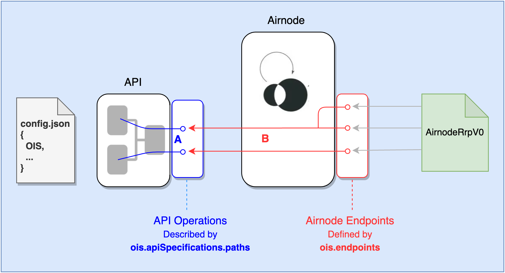

<VersionWarning/>

<PageHeader/>

<SearchHighlight/>

<FlexStartTag/>

# {{$frontmatter.title}}

OIS (or Oracle Integration Specifications) is a JSON object that describes an API specification and defines Airnode endpoints linked to API operations (a.k.a. endpoints). It is one of five root level objects in a `config.json` file that defines an Airnode.

- chains
- nodeSettings
- triggers
- ois
- apiCredentials

For more information about the config.json file see the [Deployment Files](/reference/airnode/v0.12/deployment-files/config-json.md) section in the Airnode document set.

In the diagram below, an Airnode exposes its endpoints to the on-chain AirnodeRrpV0.sol contract. Airnode uses the OIS object to map its endpoints to an API operation. It should be noted that Airnode can have more than one endpoint that maps to the same API operation.

> 
>
> - <p>A) <b>ois.apiSpecifications.paths</b>:  Describes API operations.</p>
> - <p>B)<b> ois.endpoints:  </b>Defines Airnode endpoints.</p>
>   <p>Relationships exist between an Airnode endpoint and an API operation.</p>

## API Mapping Examples

The following are three possible Airnode to API operation mapping examples. Mapping details are better documented in the next doc [Specification](/reference/ois/2.1/specification.md).

### Simple Airnode Endpoint

An API has a simple operation the returns the current value of an on-chain token `GET /token/{id}` and has `id` as its only parameter. Here the Airnode endpoint will only mimic the API operation. To do so, the Airnode will declare its endpoint to have one parameter, `id`. Airnode will accept an `id` argument from an on-chain request and move its value to the API operation's path parameter named `id`.

```json
// ois.apiSpecifications (API operations)
"paths": {
    "/token/{id}": {    <─────────────┐
        "get": {        <────────────┐│
        "parameters": [              ││
            {                        ││
                "in": "path",        ││
                "name": "id"         ││
            },                       ││
            ...                      ││
        ]                            ││
    ...                              ││
}                                    ││
                                     ││
// ois.endpoints (Airnode Endpoints) ││ Mapping between API operations and Airnode endpoints.
"endpoints": [                       ││
    {                                ││
        "name": "tokenValue",        ││
        "operation": {               ││
            "method": "get",      <──┘│
            "path": "/token/{id}" <───┘
        },
        ...
        "parameters": [
            {
                "name": "token",
                "operationParameter": {
                    "in": "path",
                    "name": "id"
                }
    ...
]
```

### Fixed Operation Parameters Airnode Endpoint

An API may have an operation that returns a crypto coin in either a summary or detail form. The API operation has two parameters, `coinId` in the path and `includeDetails` in the query. The Airnode (by design) will not allow the details of the coin to be returned, only the summary. Therefore the Airnode will require a requester to pass a `coinId` but will ignore the `includeDetails` parameter if passed. The Airnode will always set the `includeDetails` query parameter to false regardless of what a requester sends when it calls the API operation. It does so using a `fixedOperationParameters` when calling the API operation.

### Two Airnode Endpoints - One API Operation

An Airnode may wish to create two Airnode endpoints mapped to a single API operation whereas the requester does not pass any argument. While the API operation returns any token value based on a path parameter `id`, Airnode will only allow one particular token per Airnode endpoint. This is done using `fixedOperationParameters` rather than normal `parameters`. By applying a `value` to `fixedOperationParameters` for each Airnode endpoint, only the token in the `value` can be returned to the requester.

```json
"endpoints": [
    {
        "name": "tokenValueAPI3", // API3 token
        "operation": {
            "method": "get",
            "path": "/token/{id}"
        },
        ...
        "fixedOperationParameters": [
            {
                "name": "token",
                "operationParameter": {
                    "in": "path",
                    "name": "id"
                },
                "value":"API3"
    ...
    },
    {
        "name": "tokenValueMATIC", // MATIC token
        "operation": {
            "method": "get",
            "path": "/token/{id}"
        },
        ...
        "fixedOperationParameters": [
            {
                "name": "token",
                "operationParameter": {
                    "in": "path",
                    "name": "id"
                }
                "value":"MATIC"
    ...
    },
]
```

<FlexEndTag/>
